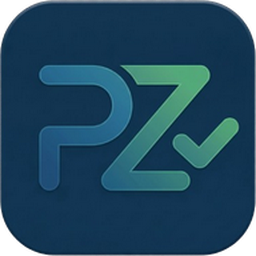
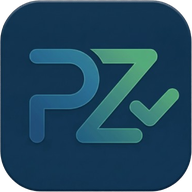
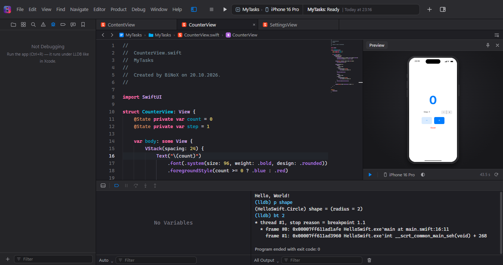
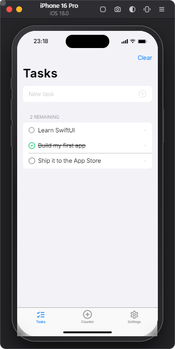
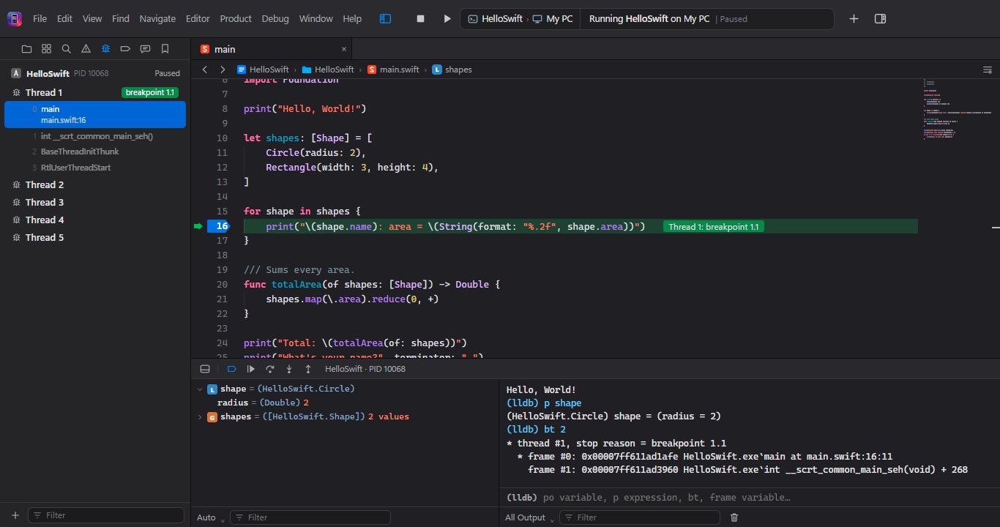
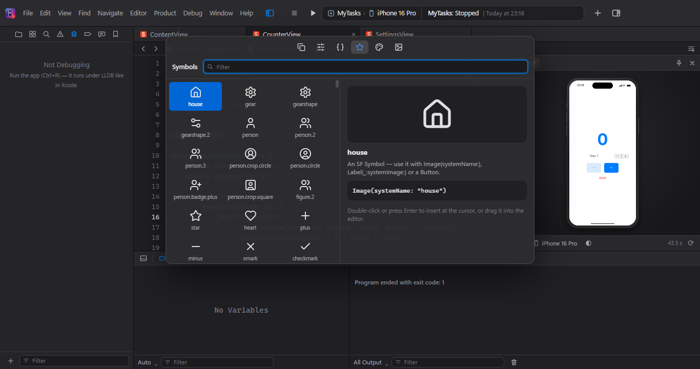

<p align="center"></p>

<h1 align="center">WinSwift Studio</h1>

<p align="center">🌐 <a href="https://winswift.tacticalops.fun/"><b>winswift.tacticalops.fun</b></a> · <a href="https://winswift.tacticalops.fun/en/">English</a></p>

<p align="center"><b>Twórz aplikacje na iPhone'a w Swift i SwiftUI — na Windows 10 i 11.</b><br>
Build iPhone apps in Swift &amp; SwiftUI on Windows — an Xcode-style IDE with an iPhone simulator, live previews and a debugger.</p>

<p align="center">
  <a href="https://github.com/CpMiko2005pl/winswift-studio/releases/latest"></a>
  
  
  
  <a href="https://winswift.tacticalops.fun/"></a>
</p>

<p align="center"><b>Sponsorzy</b></p>

<table align="center">
  <tr>
    <td align="center" width="340"><a href="https://prozlecenie.pl/?utm_source=winswift-studio&utm_medium=github"><br><b>ProZlecenie.pl</b></a><br>Zlecenia budowlane — fachowcy z Twojej okolicy sami zgłoszą się z ceną.</td>
    <td align="center" width="340"><a href="https://cyberscope.pl/?utm_source=winswift-studio&utm_medium=github"><br><b>CyberScope.pl</b></a><br>Cyberbezpieczeństwo — aktualności, analizy i poradniki o zagrożeniach w sieci.</td>
  </tr>
</table>

<p align="center"></p>

## Instalacja — 3 kroki

1. Pobierz instalator **[WinSwift-Studio-Setup.exe](https://github.com/CpMiko2005pl/winswift-studio/releases/latest)** (sekcja *Releases → Assets*), uruchom go i kliknij **Dalej → Zainstaluj**. Bez uprawnień administratora; skróty pojawią się na pulpicie i w menu Start.
2. Przy pierwszym uruchomieniu kliknij **Install Swift…** — program sam zainstaluje kompilator Swift i Visual Studio Build Tools (przez winget; Windows raz zapyta o zgodę administratora). Gdy skończy, kliknij **Retry**.
3. *Create New Project… → iOS → App* i **Ctrl+R** — aplikacja uruchomi się w symulatorze iPhone'a (pierwsze uruchomienie buduje bibliotekę SwiftUI, ok. 1–2 min).

> Windows pokazuje „System Windows ochronił ten komputer”? Kliknij **Więcej informacji → Uruchom mimo to** — program nie ma płatnego podpisu cyfrowego.

**Aktywacja:** przy pierwszym uruchomieniu wklej klucz licencyjny (`WS1-…`) albo token **15-minutowej darmowej próby** — oba są w Twoim profilu w sklepie **[xdecode.cyberscope.pl](https://xdecode.cyberscope.pl/)**. Klucz działa na jednym komputerze naraz: w *Ustawieniach → Licencja* możesz go dezaktywować i aktywować na innym. Aktywowany program działa na zawsze, także bez internetu.
**Aktualizacje:** program sam sprawdza nowe wersje (przy starcie, co kilka godzin i gdy wróci internet) i proponuje **Pobierz i zainstaluj** — aktualizacja instaluje się sama i uruchamia program ponownie; projekty i ustawienia zostają.
**Odinstalowanie:** *Ustawienia → Aplikacje → Zainstalowane aplikacje → WinSwift Studio → Odinstaluj* (Twoje projekty nie są usuwane).
**Wersja przenośna:** w *Releases* jest też `WinSwift-Studio-…-Windows-x64.zip` — rozpakuj i uruchom `WinSwift Studio.exe` albo `Zainstaluj.bat` (instrukcja w `INSTRUKCJA.txt`, odinstalowanie przez `Odinstaluj.bat`).

## Co potrafi

| | |
|---|---|
|  | **Symulator iPhone'a** — 6 modeli (iPhone 16 Pro, 16 Pro Max, 16, 16 Plus, 16e, SE), jasny/ciemny wygląd, języki, lokalizacja GPS, uprawnienia, Shake, zrzuty ekranu.<br><br>**Własna implementacja SwiftUI dla Windows** — `NavigationStack`, `List`, `Form`, `TabView`, `@State`, `@Observable`, `@AppStorage`, alerty, arkusze, gesty, `Localizable` / String Catalog, Asset Catalog i wiele więcej. |
| **Debugger LLDB** — breakpointy na marginesie, *Continue / Step Over / Into / Out* (F6/F7/F8), zmienne, stos wywołań, konsola `(lldb)` z `po` i `p`, podgląd wartości po najechaniu. |  |
|  | **Jak w Xcode** — Canvas z `#Preview`, podpowiedzi i błędy na żywo (SourceKit-LSP), Quick Help, Rename, Code Actions, Open Quickly, Find &amp; Replace w projekcie, Library (Views, Modifiers, Snippets, SF Symbols, Colors, Images), Edit Scheme, nawigatory, motyw jasny i ciemny, własne skróty klawiszowe. |

Działają też **programy konsolowe** i **Swift Package** (`swift build`).

## Ograniczenia — uczciwie

- To nie jest prawdziwy iOS: kod Swift kompiluje prawdziwy kompilator Swift, a aplikacja działa na Windows z naszą implementacją SwiftUI (najczęściej używana część API). Pliku `.ipa` i publikacji w App Store nie zrobisz — do tego potrzebny jest Mac z Xcode.
- UIKit i Storyboard nie są obsługiwane (tylko SwiftUI).
- **Windows 7 i 8 nie są obsługiwane** — kompilator Swift dla Windows i Electron wymagają Windows 10 lub 11 (64-bit).

## Ze źródeł (dla programistów)

```bat
git clone https://github.com/CpMiko2005pl/winswift-studio.git
cd winswift-studio
npm install
npm start           & rem uruchomienie
npm run installer   & rem instalator dist\WinSwift-Studio-Setup-*.exe
npm run package     & rem wersja przenośna dist\WinSwift-Studio-*-Windows-x64.zip
```

Wymagania: Node.js 18+, Swift dla Windows, Visual Studio Build Tools z C++.
Budowa: Electron + Monaco Editor, SourceKit-LSP, lldb-dap, symulator i SwiftUI w `runtime/SwiftUI`.

## Licencja

Kod: MIT — zobacz [LICENSE](LICENSE). Biblioteki: Electron, Monaco Editor (MIT), Lucide (ISC), Inter (SIL OFL).
Logo i marki sponsorów (**ProZlecenie**, **CyberScope**) należą do ich właścicieli i nie są objęte licencją MIT.

## Znaki towarowe

Projekt nie jest powiązany z Apple Inc. ani przez nią wspierany. Xcode, Swift, SwiftUI, iPhone i iOS są znakami towarowymi Apple Inc., użytymi tu wyłącznie do opisu zgodności.

---

### English

**WinSwift Studio** lets you write iPhone apps in **Swift and SwiftUI on Windows 10/11**: an Xcode-style IDE with an **iPhone simulator**, **live SwiftUI previews (Canvas)**, an **LLDB debugger** and **SourceKit code completion**. Download `WinSwift-Studio-Setup.exe` from *Releases* and install it (no admin needed); on first launch click **Install Swift…** to get the Swift toolchain and Visual Studio Build Tools via winget, then *Create New Project → iOS → App* and press Ctrl+R. The app checks GitHub for updates; uninstall from *Settings → Apps*.
Apps run on Windows through an open reimplementation of the SwiftUI API; building `.ipa` files or publishing to the App Store still needs a Mac with Xcode. Not affiliated with Apple Inc.

<sub>Keywords: swift on windows, swiftui on windows, xcode for windows alternative, ios development on windows, iphone app development windows, ios simulator for windows, learn swift windows, programowanie iOS na Windows, aplikacje na iPhone'a na Windows, Swift na Windows</sub>
